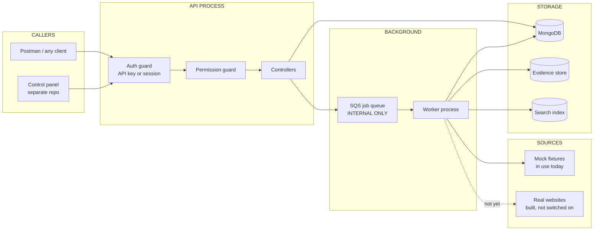
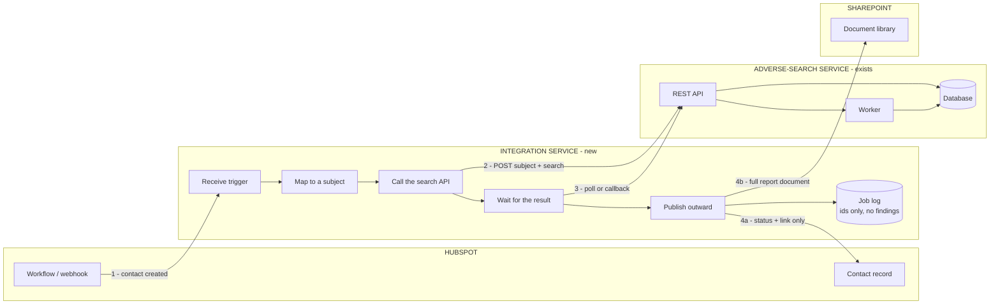
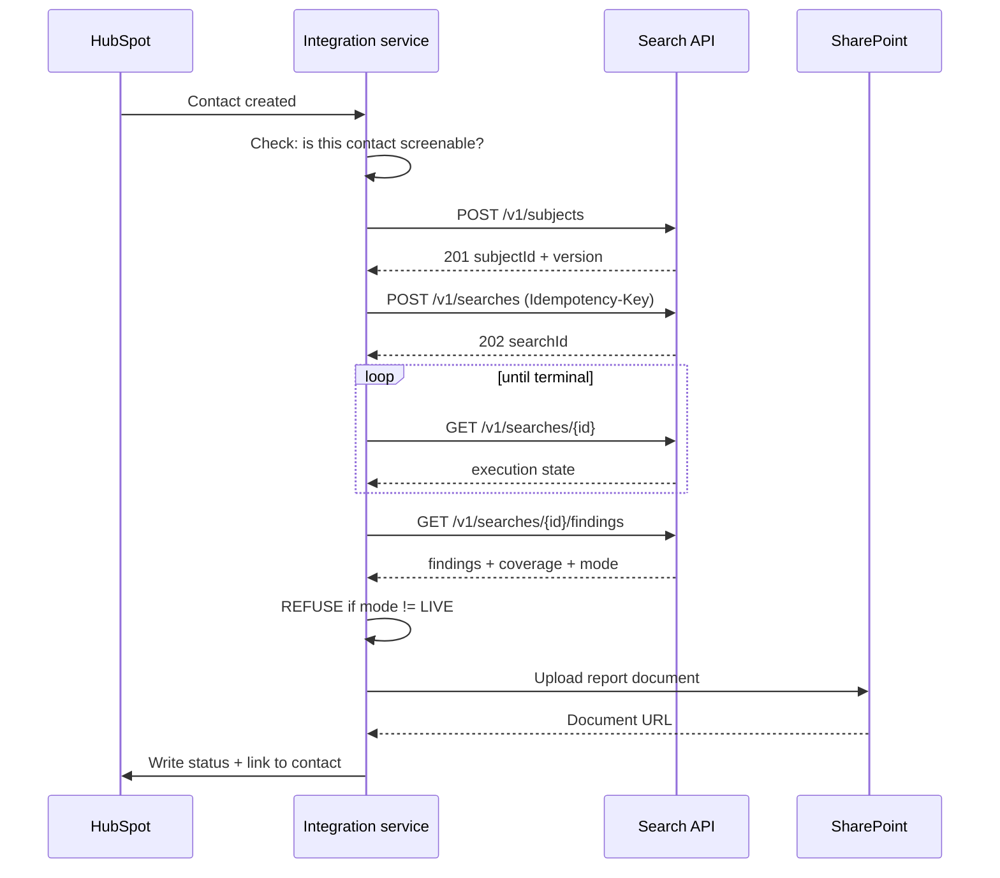
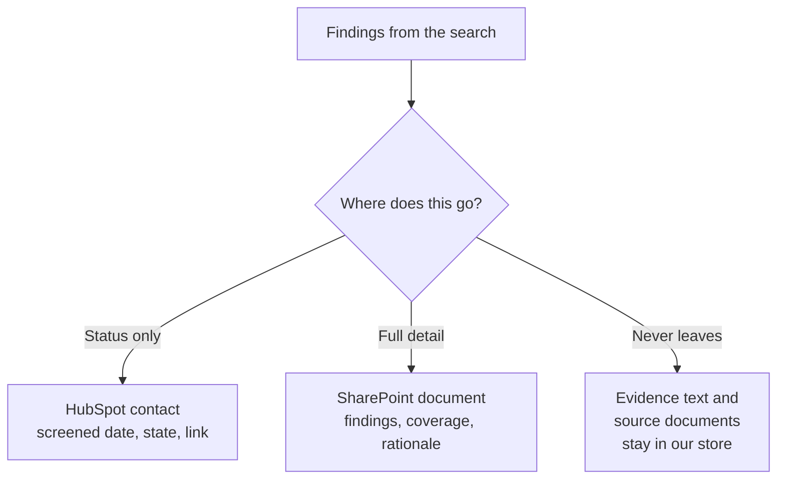
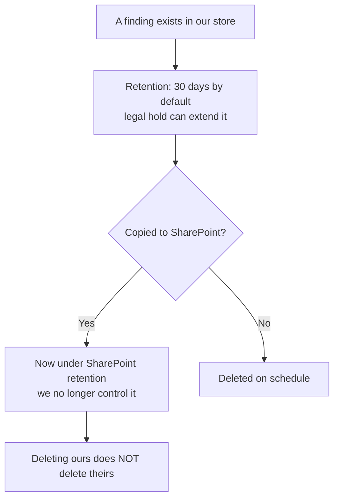

# Integration audit and proposed solution

**Date:** 2026-09-15
**Subject:** connecting HubSpot and SharePoint to the adverse-search service
**For:** the developer who will build it

---

## How to read this

- **Part 1** — what exists today, and what is solid enough to build on.
- **Part 2** — what is missing. Every item has an ID, a severity and a file you can open.
- **Part 3** — the flow we want, in diagrams.
- **Part 4** — what to build, component by component, with the reason for each.
- **Part 5** — security rules the build must follow.
- **Part 6** — data protection. Read this one even if you skip others.
- **Part 7** — the build plan, in order, with "done" defined for each step.
- **Part 8** — decisions that are not the developer's to make.

**The short version:** the core service is in good shape. Nothing connects to it yet, and two
things block any connection — nobody can be issued an API key, and no real source is switched on.
The fix is a small middle service, not changes to the core.

---

## Part 1 — What exists today

### 1.1 The audit

|                            |                                                                                  |
| :------------------------- | :------------------------------------------------------------------------------- |
| What we looked at          | The whole backend: API surface, auth, queue, storage, retention, source fetching |
| How                        | Read the code and the generated OpenAPI document. Ran the full test suite        |
| Test results at audit time | 754 unit, 29 invariants, 12 evaluation — all passing                             |
| What we did **not** do     | Run the integration and security suites. They need the stack up                  |

### 1.2 The system now



### 1.3 What is solid — do not rebuild this

| Area             | State                                                                         | Why it matters to you                                                    |
| :--------------- | :---------------------------------------------------------------------------- | :----------------------------------------------------------------------- |
| REST API         | 34 endpoints, OpenAPI generated from code                                     | Your contract. It cannot drift — a test fails if it does                 |
| API key auth     | Issue, verify, rotate, revoke, audit — all written and tested                 | The logic is there. Only the HTTP door is missing                        |
| Tenant isolation | Every query is tenant-scoped. Queue tenant field is never trusted             | You cannot accidentally read another customer's data                     |
| Idempotency      | `Idempotency-Key` header on `POST /v1/searches`                               | Retry safely. A repeat returns 200 with the same id, not a second search |
| Revisions / ETag | `GET /v1/searches/{id}` returns an `ETag`                                     | You can detect stale reads                                               |
| Audit trail      | Hash-chained per tenant                                                       | Every action is attributable                                             |
| HTTP hardening   | Helmet, CORS allowlist, 256 kb body cap                                       | Already done                                                             |
| Outbound safety  | URL screening, DNS screening, robots, two byte budgets, breakers, kill switch | The service cannot be tricked into fetching internal addresses           |
| Typed client     | `@adverse-search/client`                                                        | Use it. It stops four common mistakes                                    |

### 1.4 The API you will actually call

```
POST /v1/subjects                     → record who is being screened
POST /v1/searches                     → 202 + searchId   (a receipt, not an answer)
GET  /v1/searches/{id}                → execution + findings + coverage states
GET  /v1/searches/{id}/findings       → the findings AND the coverage, together
GET  /v1/searches/{id}/associations   → the company graph
POST /v1/searches/{id}/cancel         → stop a running search
```

Three independent state fields come back, and they must be read together:

| Field           | Values                                                                 |
| :-------------- | :--------------------------------------------------------------------- |
| `execution`     | `QUEUED`, `RUNNING`, `SUCCEEDED`, `PARTIAL`, `FAILED`, `CANCELLED`     |
| `findingsState` | `POTENTIAL_MATCHES`, `NO_MATCHES_FOUND`, `UNRESOLVED`, `NOT_EVALUATED` |
| `coverage`      | `WITHIN_DECLARED_SCOPE`, `INCOMPLETE`, `UNKNOWN`                       |

`SUCCEEDED` + `NO_MATCHES_FOUND` + `INCOMPLETE` means: **the job finished, found nothing, and did
not search everything it promised.** That is not a clean result. Never show it as one.

---

## Part 2 — What is missing

### 2.1 Summary

| ID    | Finding                                                  | Severity      |
| :---- | :------------------------------------------------------- | :------------ |
| INT-1 | No way to issue an API key                               | **BLOCKER**   |
| INT-2 | No live source is switched on                            | **BLOCKER**   |
| INT-3 | No callback when a search finishes — polling only        | HIGH          |
| INT-4 | Every record is stamped `MOCK` today                     | HIGH          |
| INT-5 | No report document. Findings are JSON only               | MEDIUM        |
| SEC-A | No rate limiting on the API                              | HIGH          |
| SEC-B | The job queue must never be exposed                      | HIGH (rule)   |
| SEC-C | The new middle service will hold two sets of credentials | HIGH (design) |
| SEC-D | No IP allowlist or scope limit per machine key           | MEDIUM        |
| CMP-1 | Retention does not follow data out of the system         | **HIGH**      |
| CMP-2 | Purpose limitation breaks when findings land in a CRM    | **HIGH**      |
| CMP-3 | No erasure propagation to external systems               | HIGH          |
| OPS-1 | Status doc has drifted from reality                      | LOW           |
| OPS-2 | No failure visibility for integration jobs               | MEDIUM        |

### 2.2 Where the gaps sit

```mermaid
flowchart LR
    subgraph ok["WORKS"]
        A1[REST API]
        A2[Auth checking]
        A3[Tenant isolation]
        A4[Idempotency]
        A5[Audit trail]
        A6[Outbound safety]
    end

    subgraph missing["MISSING"]
        B1[Issue an API key]
        B2[Callback on finish]
        B3[Report document]
        B4[Rate limiting]
        B5[Live source switched on]
    end

    subgraph absent["DOES NOT EXIST"]
        C1[HubSpot connector]
        C2[SharePoint connector]
        C3[Middle service]
    end

    ok --> missing --> absent
```



### 2.3 The findings in detail

---

**INT-1 — No way to issue an API key. BLOCKER.**

`ApiKeyService` can create, rotate, revoke, list and audit keys. All of it is written and tested.
**Nothing calls it.** `POST /v1/tenant/api-keys` is marked _Reserved — not implemented_.

_Evidence:_ `apps/api/src/tenancy/api-key.service.ts` lines 125, 237, 270. `openapi/openapi.json`.

_Why it matters:_ no integration can authenticate. This is the first thing to build.

_Fix:_ wire a controller onto the existing service. The hard part is already done.

---

**INT-2 — No live source is switched on. BLOCKER for value, not for build.**

Nothing has ever been fetched from a real website. The SEC feed is configured and ready; it has
not been activated, and it deliberately carries `robotsPosition: NOT_ESTABLISHED`, which the
fetch gate refuses.

_Evidence:_ `apps/api/src/sources/registry/sec-litigation-releases.ts`.

_Why it matters:_ you can build and test the whole integration against mock mode. But until a
source is live, a real search returns nothing real. Do not let anyone mistake that for "clean".

---

**INT-3 — No callback when a search finishes. HIGH.**

A search is asynchronous. The only way to learn it finished is to poll `GET /v1/searches/{id}`.

There is an outbox — events are written inside the database transaction and published afterwards
— but it publishes onto the **internal** queue. There is no HTTP delivery to anyone outside.

_Evidence:_ `apps/api/src/persistence/outbox.service.ts`. No webhook code exists anywhere.

_Why it matters:_ polling works and is fine to start with. At volume it wastes requests, and a
crashed poller loses the result silently.

---

**INT-4 — Every record is stamped `MOCK`. HIGH.**

`GET /v1/searches/{id}/findings` returns `mode: "MOCK" | "LIVE"`. Today it is always `MOCK`.

_Why it matters:_ if the integration writes a `MOCK` finding into a real CRM record, someone will
make a real decision about a real person based on test data.

_Rule for the build:_ **the integration must refuse to write anything downstream when
`mode !== "LIVE"`.** Not a warning. A hard refusal, with a test.

---

**INT-5 — No report document. MEDIUM.**

Findings come back as JSON. SharePoint wants a document.

_Why it matters:_ someone has to decide what the document looks like and render it. That is real
work and it is easy to underestimate — it must carry the coverage statement and the rationale,
not just a list of hits.

---

**SEC-A — No rate limiting. HIGH.**

`RATE_LIMITED` (429) exists as an error code in the contracts. The OpenAPI document lists 429 as a
response for `POST /v1/searches`. **Nothing in the API throws it.** There is no throttle guard.

_Evidence:_ `packages/contracts/src/errors/errors.ts` line 45. No match for a throttler anywhere
in `apps/api/src`.

_Why it matters:_ a looping integration — a HubSpot workflow misconfigured to fire on every
contact update — can run thousands of searches. Each one costs source requests, storage, and
possibly the relationship with a publisher. The service protects publishers from us carefully and
does not yet protect itself from its own callers.

---

**SEC-B — The job queue must never be exposed. HIGH (design rule).**

You may be asked "can HubSpot read the queue?". The answer is no, and this is why:

- The queue carries _"run search X for tenant Y"_ — never results.
- Its `tenantId` field is explicitly **not** an authority. We re-verify ownership against the
  database on every delivery. An outside reader would be trusting a field we do not trust.
- It is an implementation detail. Exposing it freezes it.

_Evidence:_ `apps/api/src/jobs/queue.port.ts`, the `JobEnvelope` comment.

_Rule:_ external systems talk to the REST API. Nothing else.

---

**SEC-C — The middle service holds two sets of credentials. HIGH (design).**

It will hold our API key **and** HubSpot/SharePoint credentials. That makes it the highest-value
target in the picture.

_Requirements are in Part 5._ The short version: no findings stored at rest, outbound allowlist,
secrets from a manager not from env files, and its own audit trail.

---

**SEC-D — No IP allowlist or per-key scope limit. MEDIUM.**

A key carries roles and scopes, and the fields exist. There is no way to say "this key may only be
used from these addresses" or "this key may only create searches, never read admin".

_Why it matters:_ a leaked integration key today has the full permissions of its roles from
anywhere.

---

**CMP-1 — Retention does not follow the data out. HIGH.**

Evidence retention here is 30 days by default, configurable per policy version, and a legal hold
overrides it. A finding copied into HubSpot or SharePoint is then under **their** retention rules.
Deleting it here does not delete it there.

_Evidence:_ decision D-012; `apps/api/src/persistence/retention.service.ts`.

_Why it matters:_ this is the single biggest compliance risk in the whole integration. It is not
an engineering problem — it is a decision. See Part 8.

---

**CMP-2 — Purpose limitation breaks in a CRM. HIGH.**

Every subject must declare a `purpose` — one of `CUSTOMER_ONBOARDING`, `PERIODIC_REVIEW`,
`ENHANCED_DUE_DILIGENCE`, `TRANSACTION_MONITORING_ESCALATION`, `SUPPLIER_DUE_DILIGENCE`,
`EMPLOYEE_SCREENING`. The service records why the person was screened.

A CRM is seen by sales. A screening system is seen by compliance, under roles and audit. Copying
adverse-media claims about a named person into the first is a different risk category from holding
them in the second.

_Recommendation:_ HubSpot receives **a status and a link**, never the findings. See Part 4.2.

---

**CMP-3 — No erasure propagation. HIGH.**

If a person asks to be erased, we can delete here. Nothing tells HubSpot or SharePoint.

_Fix:_ the middle service must keep a map of what it wrote where, so erasure can be carried out.
That map is itself personal data and must be minimal — ids and locations, never content.

---

**OPS-1 — Docs drift. LOW.**

`docs/implementation-status.md` says the integration and security suites are unimplemented.
`docs/execution/START-HERE.md` says they hold 206 and 106 tests.

_Why it matters:_ small, but a developer trusting the wrong file wastes a day.

---

**OPS-2 — No failure visibility for integration jobs. MEDIUM.**

Internal jobs have a dead-letter queue. A failed push to HubSpot or SharePoint would have nowhere
to go.

---

## Part 3 — The flow we want

### 3.1 Target architecture



### 3.2 The sequence, step by step



### 3.3 What goes where — and what does not



**The rule:** detail flows to the controlled document store. Only a pointer flows to the CRM.

---

## Part 4 — What to build

### 4.1 The integration service

A small, separate service. Not part of the core backend.

**Why separate, and not endpoints on the core API:**

1. **Credentials.** It holds HubSpot and SharePoint secrets. The core service must never hold a
   customer's CRM credentials.
2. **Blast radius.** A bad connector deploy must not be able to take down screening.
3. **It is per-customer.** One customer uses HubSpot, the next uses Salesforce. That belongs
   outside a core that is the same for everyone.
4. **The core stays honest.** It answers questions about people. It does not know what a CRM is.

**What it does:**

| Job                   | Detail                                              |
| :-------------------- | :-------------------------------------------------- |
| Receive triggers      | HubSpot webhook, or a scheduled sweep               |
| Decide what to screen | Not every contact. Filtered by a rule you configure |
| Map fields            | HubSpot contact → `CreateSubjectRequest`            |
| Call the API          | Using our typed client, with an idempotency key     |
| Wait                  | Poll, or receive a callback once INT-3 is built     |
| Refuse `MOCK`         | Hard stop if `mode !== "LIVE"`                      |
| Render the report     | Findings + coverage + rationale → a document        |
| Push outward          | SharePoint upload, HubSpot status write-back        |
| Record what it did    | Ids and destinations only. **No findings at rest**  |

**What it must NOT do:**

- Store findings.
- Decide whether someone is risky. It moves data; it does not judge.
- Turn a band into a number, a colour or a score.
- Write the words "clear", "clean" or "no adverse media" anywhere.

### 4.2 HubSpot connector

**Inbound trigger.** A HubSpot workflow calls a webhook when a contact or company is created or
changes.

**Field mapping.** The minimum the service needs is a name. Anything else improves accuracy.

| HubSpot            | Our field            | Notes                                               |
| :----------------- | :------------------- | :-------------------------------------------------- |
| First + last name  | `fullName`           | Required                                            |
| Country            | `countryContext`     | 2-letter codes, improves matching                   |
| Date of birth      | `dateOfBirth`        | Rarely present. Helps a lot when it is              |
| Associated company | `knownCompanies`     | Labelled as user-supplied, unverified               |
| Record id          | `externalSubjectRef` | So you can find it again                            |
| Deal or case id    | `externalCaseRef`    | Ties the search to a case                           |
| —                  | `purpose`            | **Required.** You must decide which one. See Part 8 |

**Write-back — what goes on the contact record:**

| Property                     | Example                                         |
| :--------------------------- | :---------------------------------------------- |
| `adverse_screening_status`   | `Screened` / `Screened — incomplete` / `Failed` |
| `adverse_screening_date`     | `2026-09-15`                                    |
| `adverse_screening_result`   | `Potential matches` / `No matches found`        |
| `adverse_screening_coverage` | `Full` / `Partial — see report`                 |
| `adverse_screening_report`   | Link to the SharePoint document                 |

**Not on the contact record:** names of findings, headlines, allegations, bands, URLs to articles.

**Why so little:** see CMP-2. The CRM is a wide audience. The report is a narrow one.

**The coverage field is not optional.** If coverage is `INCOMPLETE`, the status must say so. A
screening that missed half its sources looking identical to one that checked everything is the
exact failure this whole product is built to prevent.

### 4.3 SharePoint connector

Upload via Microsoft Graph. App-only authentication, one site, one library.

**Suggested layout:**

```
/Adverse Screening/
    2026/
        09/
            {externalCaseRef}-{searchId}.pdf
```

**The document must contain**, not optionally:

1. Who was screened, and the purpose.
2. When, and which search id.
3. **The coverage statement** — what was searched and what was not.
4. Findings, each with its band, its four axis values and its rationale.
5. Rejected leads with their reasons — evidence of diligence.
6. `noMatchStatement` verbatim where there are no findings.
7. The `mode` — `LIVE`.

**Why the rationale must be there:** a band on its own cannot be reviewed, only believed.

### 4.4 Core service changes

Small, and all in the existing style.

| ID  | Change                                        | Effort                                        |
| :-- | :-------------------------------------------- | :-------------------------------------------- |
| C1  | Expose API key issue / list / rotate / revoke | Small — service exists, add a controller      |
| C2  | Rate limiting per key and per tenant          | Medium                                        |
| C3  | Webhook delivery on search completion         | Medium — outbox exists, add an HTTP publisher |
| C4  | Report render endpoint                        | Medium — or do it in the middle service       |

**C1 first.** Nothing works without it.

**C3 is optional at first.** Polling works. Add the callback when volume makes polling wasteful.

---

## Part 5 — Security rules for the build

These are requirements, not suggestions. Each one exists because of a specific way this goes
wrong.

### 5.1 Secrets

- Secrets come from a secret manager. Never from a `.env` file in a repo, never from a HubSpot
  workflow field.
- Our API key is shown once at creation and is not recoverable. Store it immediately.
- Use a **separate key per connector**. If the SharePoint push is compromised, revoke that key
  without stopping HubSpot.
- Rotate on a schedule. `rotate()` already exists and keeps the old key valid briefly.

### 5.2 Network

- The integration service makes outbound calls to **three hosts only**: our API, HubSpot, and
  Microsoft Graph. Everything else is blocked at egress.
- _Why:_ it holds credentials. An allowlist means a compromised dependency cannot phone home.
- Our API should be reachable from the integration service only — private networking or an IP
  allowlist. It does not need to be on the public internet.

### 5.3 Data at rest

- **The integration service stores no findings.** Ever.
- What it may store: search id, subject id, external record id, destination document id,
  timestamps, status.
- _Why:_ a store of findings is a second copy of the most sensitive data in the system, with none
  of the controls the first copy has.

### 5.4 Refusals that must be hard failures

| Condition                | Behaviour                                     |
| :----------------------- | :-------------------------------------------- |
| `mode !== "LIVE"`        | Refuse to write anything downstream           |
| `execution` not terminal | Do not read findings. Keep waiting            |
| `execution === FAILED`   | Write a failure status. Do not write a result |
| Missing `purpose`        | Refuse to create the subject                  |
| API returns 403          | Stop. Alert. Do not retry with another key    |

That last one matters. Retrying a 403 from a second identity is the pattern this project refuses
everywhere else, and the reasoning does not change because the other end is HubSpot.

### 5.5 Logging

- Never log a full name, a finding, a headline or an evidence URL.
- Log ids, states and timings.
- _Why:_ logs are copied to places findings are not allowed to go.

---

## Part 6 — Data protection

**Read this part before writing code.**



Four questions that need answers before go-live. They are in Part 8 because they are not
engineering decisions.

1. **How long does the report live in SharePoint?** Ours is 30 days. Theirs is probably years.
2. **Who can open the library?** If it is the whole company, the purpose limitation is gone.
3. **What happens on an erasure request?** Someone must be able to delete in both places. The
   integration service's job log is what makes that possible.
4. **Does the screened person get told?** Screening a person usually creates an obligation to
   inform them. That obligation does not come from this service, but the service makes it real.

---

## Part 7 — Build plan

### Phase 0 — Unblock. Nothing works without this.

| Step                                    | Done when                                            |
| :-------------------------------------- | :--------------------------------------------------- |
| Expose API key endpoints (C1)           | A tenant admin can create a key and it authenticates |
| Issue a sandbox key for the integration | The key exists and is stored in a secret manager     |

### Phase 1 — Prove the path, mock mode.

| Step                          | Done when                                                          |
| :---------------------------- | :----------------------------------------------------------------- |
| Skeleton integration service  | It starts, reads config from a secret manager, health check passes |
| Create a subject and a search | A search runs end to end via the service and returns a result      |
| Refuse `MOCK` downstream      | A test proves nothing is written when `mode !== "LIVE"`            |
| Idempotency                   | Firing the same trigger twice produces one search, not two         |

### Phase 2 — SharePoint.

| Step                  | Done when                                                     |
| :-------------------- | :------------------------------------------------------------ |
| Render the report     | A document is produced containing all seven required elements |
| Upload via Graph      | The file lands in the right folder and the URL comes back     |
| Retry and dead-letter | A failed upload retries, then lands somewhere visible         |

### Phase 3 — HubSpot write-back.

| Step                       | Done when                                        |
| :------------------------- | :----------------------------------------------- |
| Create the five properties | They exist in HubSpot with the right types       |
| Write status + link        | A contact shows the result and the report link   |
| Incomplete coverage shows  | A `PARTIAL` search visibly says so on the record |
| Nothing sensitive written  | A test asserts no finding text reaches HubSpot   |

### Phase 4 — Harden.

| Step                  | Done when                                         |
| :-------------------- | :------------------------------------------------ |
| Rate limiting (C2)    | A looping caller gets 429, not unlimited searches |
| Egress allowlist      | Only three hosts reachable                        |
| Erasure path          | Given a subject id, both copies can be removed    |
| Webhook delivery (C3) | Polling can be switched off                       |

### Phase 5 — Go live.

Only after a real source is approved and switched on.

| Step                  | Done when                                                         |
| :-------------------- | :---------------------------------------------------------------- |
| Approve a live source | A named person signs off. `mode` becomes `LIVE`                   |
| Run in parallel       | Real searches, results reviewed by a person, nothing auto-written |
| Switch on write-back  | After the parallel run is signed off                              |

---

## Part 8 — Decisions that are not the developer's

Give these to whoever owns the product and compliance. Building around a guess here is expensive
to undo.

| #   | Decision                                                          | Who             |
| :-- | :---------------------------------------------------------------- | :-------------- |
| 1   | Which `purpose` applies to HubSpot-triggered screening            | Compliance      |
| 2   | How long reports live in SharePoint, and who can open the library | Compliance + IT |
| 3   | Whether findings may appear in HubSpot at all, or only a link     | Compliance      |
| 4   | Who is told when screening finds something                        | Compliance      |
| 5   | What happens on an erasure request, in both systems               | Compliance      |
| 6   | Which contacts get screened — all, or a filtered set              | Product         |
| 7   | Whether a failed screening blocks a deal, or just flags it        | Product         |

**The engineering recommendation on #3 is: only a link.** Everything in Part 4.2 assumes that.
If the answer comes back differently, the write-back design changes and this document needs
revising.

---

## Appendix A — Minimum working call sequence

```
# 1. Create the subject
POST /v1/subjects
Authorization: ApiKey erly_sandbox_<id>_<secret>
{
  "fullName": "Jane Marie Whitfield",
  "countryContext": ["GB"],
  "externalSubjectRef": "hubspot-contact-12345",
  "purpose": "CUSTOMER_ONBOARDING"
}
→ 201 { "subjectId": "...", "version": 1 }

# 2. Start the search
POST /v1/searches
Idempotency-Key: hubspot-contact-12345-2026-09-15
{
  "subjectRef": { "subjectId": "...", "version": 1 },
  "externalCaseRef": "deal-9876",
  "requestedScope": { "jurisdictions": ["GB"], "languages": ["en"] },
  "environment": "sandbox"
}
→ 202 { "searchId": "...", "statusUrl": "...", "execution": "QUEUED" }

# 3. Poll until terminal
GET /v1/searches/{searchId}
→ 200 { "execution": "SUCCEEDED", "findings": "...", "coverage": "..." }

# 4. Read the result
GET /v1/searches/{searchId}/findings
→ 200 { "mode": "MOCK", "findingsState": "...", "coverage": "...",
        "noMatchStatement": {...}, "findings": [...],
        "rejectedLeads": [...], "sourceOutcomes": [...] }
```

Use `@adverse-search/client` rather than raw HTTP. `waitForSearch` handles step 3 and **throws on
timeout** instead of returning a half-finished run as though it were finished.

## Appendix B — Files worth reading first

| File                               | Why                                   |
| :--------------------------------- | :------------------------------------ |
| `docs/integration/target-platform.md`      | The four things integrators get wrong |
| `examples/target-platform-integration.mjs` | A working end-to-end call sequence    |
| `packages/client/`                 | The typed client                      |
| `openapi/openapi.json`             | The contract. Import into Postman     |
| `docs/SIMPLE-STATUS.md`            | Where the project is, in plain words  |
| `docs/SIMPLE-FLOW.md`              | The same, as diagrams                 |
