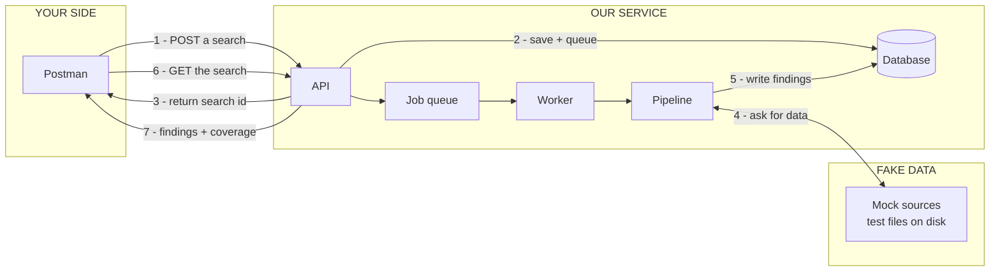
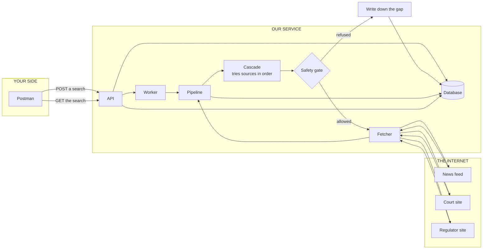
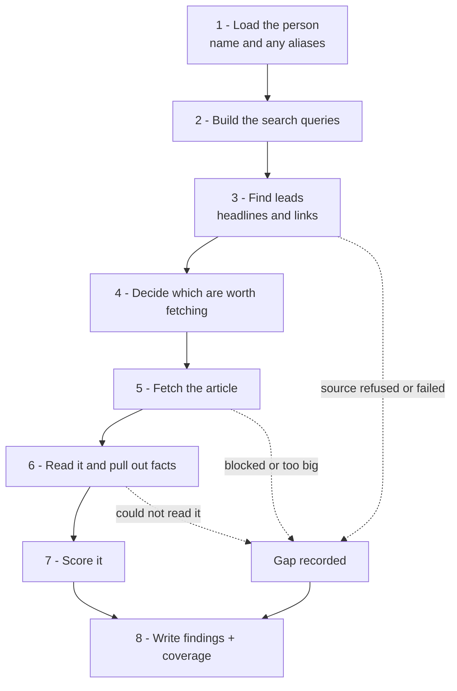
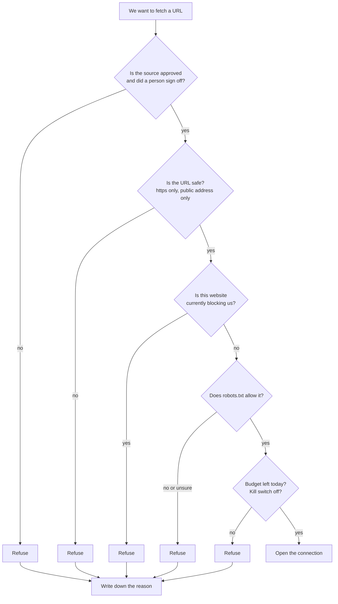
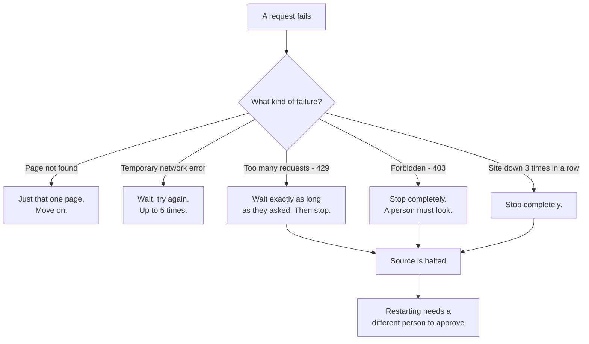
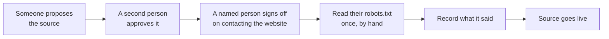

# How the data flows — in pictures

Last updated: 2026-09-15

Companion to [`SIMPLE-STATUS.md`](./SIMPLE-STATUS.md). That one says what is built. This one
shows how things move.

Two views of the same system:

- **Today** — what really happens when you press send in Postman right now.
- **Live** — what happens once real sources are switched on.

---

## 1. Today — mock mode

This is what runs on your machine right now. Nothing leaves the machine.

**The short version:** you ask, we answer immediately with an id, a worker does the real work in
the background, you come back and read the result.

**Steps 1 to 3 are fast on purpose.** We do not make you wait while the search runs.

---

## 2. Live — what it will look like

Same left half. The right half changes: fake files become real websites, and a safety gate
appears in between.

**The one thing to notice:** a refused request does not disappear. It gets written down and shows
up in your results as a gap. You always know what we could not check.

---

## 3. Inside the pipeline

What the worker actually does, in order.

**A lead is not a finding.** A headline is a claim about an article. Until we fetch and read the
article, it stays a lead.

---

## 4. The safety gate

Every single request to a real website passes through this, in this order. If any step says no,
no connection is opened.

**Unsure means no.** If a website is down and we cannot read its `robots.txt`, we do not fetch.
A site being offline is not the same as a site saying yes.

---

## 5. What happens when something goes wrong

**Two different levels of stopping:**

- **Breaker** — automatic, temporary. Comes back on its own after a cooldown.
- **Halt** — a person has to look at it and a second person has to restart it.

---

## 6. Adding a new source

No code change. No deploy.

**Step C is separate from step B on purpose.** Step B says "the settings are correct". Step C
says "I accept that we will start contacting this website". Different things, different
signatures.

Until step C is done, the source sits in the system fully configured and **never gets contacted**.

---

## 7. Today vs live — side by side

|                               | Today                    | Live                     |
| :---------------------------- | :----------------------- | :----------------------- |
| Where data comes from         | Test files on disk       | Real websites            |
| Requests leaving your machine | None                     | Only to approved sources |
| Safety gate                   | Runs, always passes      | Runs, can refuse         |
| Results                       | Real shape, fake content | Real                     |
| Speed                         | Instant                  | Depends on the sites     |
| Coverage gaps shown           | Yes                      | Yes                      |

The **shape** of everything is the same in both. That is deliberate. Switching to live does not
change the flow, only what is at the far end of it.

---

## 8. Where we are on this diagram right now

| Part                                  | Built?          |
| :------------------------------------ | :-------------- |
| Postman to API to worker to results   | Done            |
| Pipeline steps 1, 2, 7, 8             | Done            |
| Safety gate, all five checks          | Done and tested |
| Failure handling and stopping         | Done and tested |
| Reading RSS feeds                     | Done and tested |
| Cascade - trying sources in order     | **Not built**   |
| Pipeline steps 4, 5, 6 with real data | **Basic only**  |
| Any real website contacted            | **Never**       |
